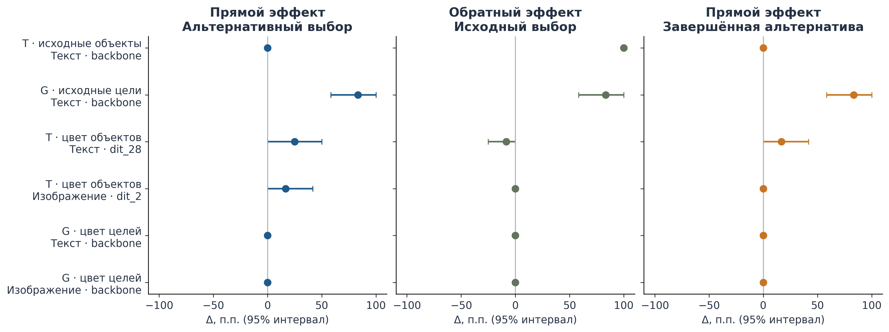
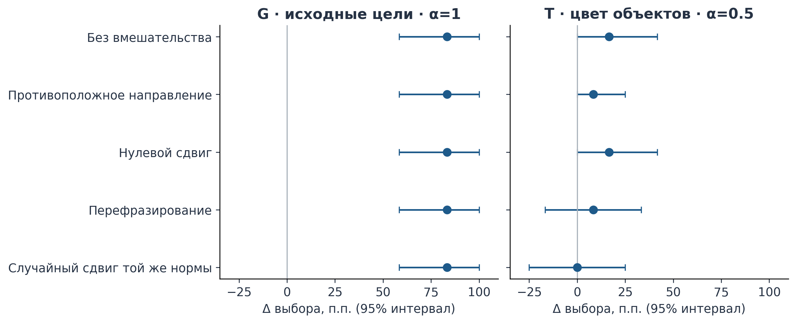
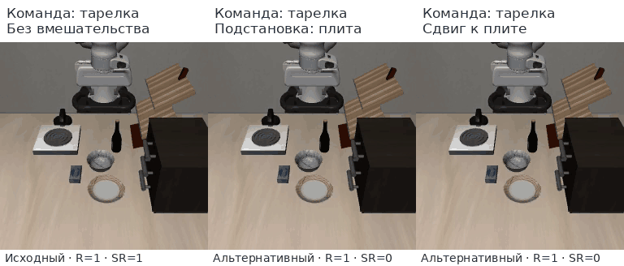
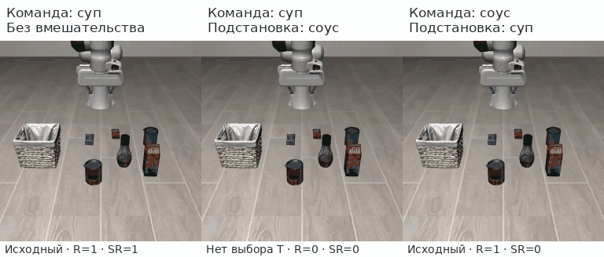
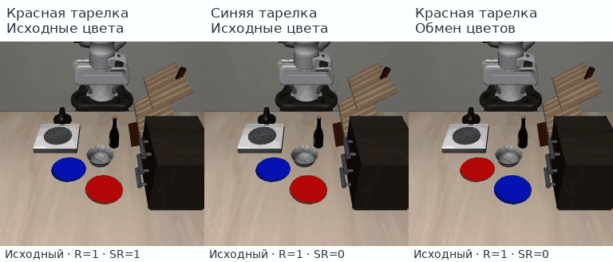
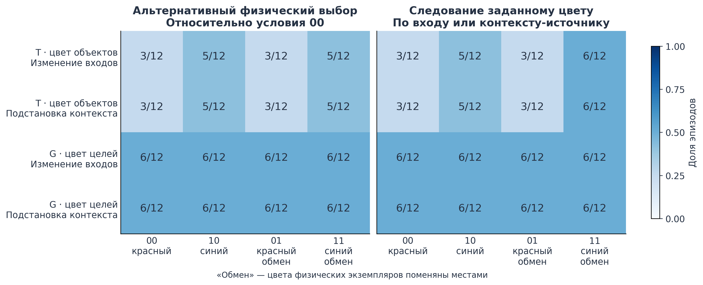
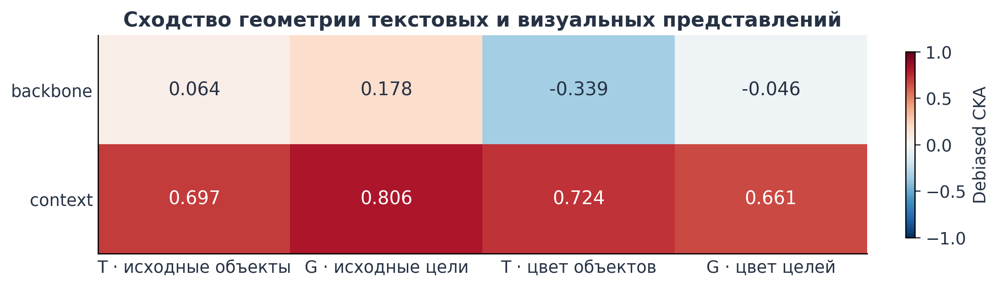

# Можно ли изменить «что» и «куда» в действии VLA?

*GR00T N1.7 × LIBERO: первичная проверка постановки и предварительные результаты*

В этом эксперименте я попробовал изменить решение робота через внутренние состояния модели: например, перенести ту же миску на другое место, сохранив захват и корректное размещение. Для места назначения это получилось: подстановка активаций и добавление фиксированного направления переключили цель в **10 из 12 отложенных сцен**, причём альтернативное действие было завершено. Для выбора объекта сопоставимого результата пока нет. Цветовая проверка выявила ещё одно ограничение: средние 50% правильных ответов могут скрывать постоянный выбор одного физического экземпляра.

Это первый ограниченный эксперимент: проверка того, работают ли постановка, вмешательства и оценивание достаточно согласованно, чтобы переходить к основному исследованию. Его результат - работающий пример управления назначением и более ясные границы дальнейшего исследования.

## От литобзора к исследовательскому вопросу

VLA - модель, которая получает изображение, языковую инструкцию и состояние робота, а выдаёт действия. Команду «возьми банку супа и положи в корзину» можно разложить на три составляющие: **T - что взять; G - куда перенести; R - в каком отношении разместить**, например внутри корзины или на тарелке.

Исследовательский вопрос: **можно ли избирательно менять эти составляющие через внутренние состояния готовой VLA, сохраняя остальные требования, переносить такое управление на новые сцены и сочетать отдельные изменения?** Здесь проверяется первая часть более широкой постановки.

В LIBERO-CF показано, что робот может воспроизводить привычное для сцены действие вопреки изменённой инструкции; поэтому авторы отдельно оценивают контакт с указанной целью и полное выполнение [1]. В работе, сопровождающей Action Atlas, подстановка активаций переносит поведение, но иногда вместе с привязкой движения к координатам исходной сцены [2]. Следовательно, изменение траектории ещё не устанавливает управление нужной составляющей задачи. Требуется проверить, **что именно изменилось, завершено ли действие и сохранились ли остальные требования**.

Из этой логики следуют три гипотезы:

| Гипотеза | Какой результат требуется |
|---|---|
| **H1. Избирательность** | Изменить T, G или R в заданную сторону, сохранив остальные составляющие. Для подстановки проверить обратное направление; в полном протоколе - также перенос на новую геометрию. |
| **H2. Перенос между текстом и изображением** | Получить направленный эффект и при смене инструкции, и при смене различающего визуального признака. Направление, построенное одним способом, должно действовать и при другом способе задания цели. |
| **H3. Сочетаемость** | Совместить отдельно подтверждённые изменения T и G, сохранив R, без подстановки готового примера нужного сочетания. |

## Что и как проверялось

Использовалась готовая модель `nvidia/GR00T-N1.7-LIBERO`, без дополнительного обучения. Задачи выбора объекта и назначения используют соответствующие наборы весов Object и Goal; активации между ними не переносились. Проверены четыре семейства условий:

| Обозначение в данных | Альтернативы | Полный успех без вмешательства: исходная / альтернативная команда |
|---|---|---:|
| `T_native` | Банка супа / банка соуса → одна корзина | 12/12 / 0/12 |
| `G_native` | Одна миска → тарелка / плита | 11/12 / 11/12 |
| `T_color` | Красная / синяя одинаковые банки → корзина | 3/12 / 5/12 |
| `G_color` | Одна миска → красная / синяя одинаковые тарелки | 6/12 / 6/12 |

`native` обозначает исходные объекты среды, `color` - варианты с одинаковыми по форме экземплярами разных цветов. Цвета физических экземпляров чередовались между сценами.

На семейство выделены **8 сцен для исследования и 12 отложенных сцен для оценки**. Сцена - начальная конфигурация внутри одного шаблона. Место вмешательства, направление и сила выбирались на первых восьми сценах и фиксировались до отложенной проверки. Сравниваемые условия начинались из одной конфигурации. Использован один основной seed - 17, задающий случайность прогона.

**Подстановка активаций - activation patching.** В текущем состоянии робота вычисляются внутренние состояния для двух входов: например, «миску на тарелку» и «миску на плиту». Состояние второго входа подставляется в выполнение первого; альтернативная траектория сама по себе не исполняется. Прямая подстановка должна направить к альтернативе, обратная - вернуть исходный выбор. Шум генерации действий в парных вычислениях согласован. Метод следует логике причинных подстановок [2, 3].

Проверялись восемь участков: выход визуально-языкового модуля (`backbone`), подготовленный общий контекст генератора (`context`) и выходы шести ранних, средних и поздних блоков трансформера действий DiT. Участок выбирался по среднему прямому и обратному эффекту на разработочных сценах; CKA в выборе не участвовала. Для T вмешательство действовало до устойчивого захвата, для G - после захвата миски.

**Направленный сдвиг - steering.** Вместо нового донорского состояния в каждом вызове использовалась средняя разность, построенная на разработочных сценах:

$$h'=h+\alpha\Delta h,\qquad \Delta h=\frac{1}{m}\sum_{j=1}^{m}(h_{1,j}-h_{0,j}).$$

Здесь $h$ - изменяемые активации, $h_{0,j}$ и $h_{1,j}$ - состояния исходной и альтернативной инструкций в одной сцене, $m=8$ - число источников, $\alpha$ - сила сдвига. Для G источники извлекались после захвата, чтобы направление соответствовало фазе переноса. Средняя контрастная разность заимствована из Contrastive Activation Addition [4]; применение к фазам действия VLA - моя адаптация.

Контроли включали самоподстановку, нулевой сдвиг, обратный знак, равнозначную переформулировку инструкции и случайное изменение той же нормы. Они позволяют проверить, связан ли эффект с содержанием вмешательства, а не с произвольным изменением.

## Как читать метрики

**Исходный вариант** - цель исходной команды; **альтернативный** - цель, к которой должно направить вмешательство. Например, для G это тарелка и плита. Эти роли не равны постоянным физическим номерам объектов.

| Показатель | Определение и смысл | Происхождение |
|---|---|---|
| **Доли исходного и альтернативного выбора**, `choice0` и `choice1` | Число эпизодов с соответствующим выбором, делённое на число всех эпизодов условия. Для T фиксируется первый устойчивый захват объекта исследуемой пары; для G - достижение области назначения после захвата. Завершение размещения не требуется. Если ни один вариант не выбран, оба показателя равны нулю. | Адаптация разделения выбора цели и полного выполнения из LIBERO-CF [1]. |
| **Доля полного успеха**, `success`, или SR | Доля эпизодов, где выполнены все требования полученной команды: правильные объект, назначение и размещение. | Стандартная оценка выполнения [1, 2], с оценщиком данного протокола. |
| **Доля завершённых альтернатив**, `select1` | Доля эпизодов с нужным альтернативным действием и сохранением остальных требований. При изменении T: альтернативный объект корректно помещён в прежнюю корзину. При изменении G: прежняя миска корректно помещена на альтернативную цель. | Это оценка избирательности H1, мотивированная причинной постановкой [5]. Статья не задаёт эту конкретную формулу. |
| **Сохранность остальных требований** | Отдельно проверяются неизменяемый фактор и размещение R: например, при изменении G объект должен остаться прежним. | Проверка интерпретации вмешательства помимо изменения поведения [5, 6]. |
| **Переключения в парных сценах** | Число сцен, где без вмешательства выбран исходный вариант, а с вмешательством - альтернативный. Отдельно считаются случаи «не выбран ни один вариант → выбрана альтернатива». Сравниваются два эпизода одной сцены. | Дополнительная проверка анализа. |
| **Следование цвету** | Доля выборов экземпляра указанного цвета. Дополнительно проверяются смена физического экземпляра и правильность в обоих эпизодах пары при смене текста или обмене окраски. | Проверка предпосылок H2, мотивированная контрфактическими инструкциями [1]. |

Устойчивый захват требует контакта и подъёма объекта более чем на 1,5 см на трёх шагах. Для G область назначения определяется по расстоянию менее 9 см в горизонтальной плоскости. **R равно единице**, если выполнено отношение «внутри» или «на», есть физический контакт с целью, объект отпущен и результат удерживается пять шагов. Приближение к тарелке поэтому ещё не считается успешным размещением.

Полный успех и завершённая альтернатива отвечают на разные вопросы. Если команда просит тарелку, а вмешательство успешно направило миску на плиту, `success` исходной команды уменьшается, а `select1` увеличивается. Для проверки управляемости это ожидаемо.

Эффект - **парная разность долей** на тех же сценах:

$$\Delta=\frac{1}{n}\sum_{i=1}^{n}(z_i^{\text{вмешательство}}-z_i^{\text{сравнение}}).$$

Здесь $z_i$ равно 1, если оцениваемый исход произошёл в сцене $i$, и 0 иначе; $n=12$. Например, рост с 3/12 до 6/12 - **+25 процентных пунктов**, далее п.п. Сравнением служит обычный запуск или контрольное вмешательство. Для обратной подстановки оценивается прирост исходного выбора относительно альтернативной команды.

95% интервалы эффектов получены из 10 000 бутстреп-перевыборок сцен: все условия одной сцены переносятся вместе. Они описывают неопределённость по сценам при одном seed. Неудачи остаются в знаменателях, включая отсутствие захвата или активного вмешательства. При небольшой выборке и нескольких сравнениях результаты рассматриваются как предварительные.

## Результаты: место назначения управляемо, выбор объекта - пока нет

Завершено **1758 эпизодов: 1014 исследовательских и 744 тестовых**. Основные записи и контроли согласованы, но слабая исходная компетентность не позволяет одинаково интерпретировать все семейства.

В таблице приведены прямые эффекты. Последний столбец показывает **смену уже зарегистрированного исходного выбора между парными эпизодами**, а не просто рост доли альтернативы.

| Условие | Альтернативный выбор: без → с вмешательством | Прирост, п.п. [95% интервал] | Завершённая альтернатива с вмешательством | Исходный → альтернативный выбор |
|---|---:|---:|---:|---:|
| G, исходные цели: подстановка | 0/12 → **10/12** | **+83,3 [58,3; 100,0]** | **10/12** | **10/12** |
| G, исходные цели: сдвиг | 0/12 → **10/12** | **+83,3 [58,3; 100,0]** | **10/12** | **10/12** |
| T, исходные объекты: подстановка | 0/12 → 0/12 | 0,0 [0,0; 0,0] | 0/12 | 0/12 |
| T, цвет: текстовая подстановка | 3/12 → 6/12 | +25,0 [0,0; 50,0] | 5/12 | 0/12 |
| T, цвет: визуальная подстановка | 3/12 → 5/12 | +16,7 [0,0; 41,7] | 3/12 | 0/12 |
| T, цвет: сдвиг | 3/12 → 5/12 | +16,7 [0,0; 41,7] | 4/12 | 0/12 |
| G, цвет: текстовая / визуальная подстановка | 6/12 → 6/12 | 0,0 [0,0; 0,0] | 6/12 | 0/12 |

*На рисунке ΔC₁ - прирост альтернативного выбора; ΔC₀ - прирост исходного выбора при обратной подстановке; ΔY₁ - прирост завершённых альтернатив. Отрезки показывают 95% интервалы.*

Для **G_native** получен избирательный эффект. Миска остаётся прежней в 12/12 сцен; R сохраняется на уровне 11/12, как без вмешательства, без парных потерь. Прямая подстановка переключает тарелку на плиту и завершает перенос в 10/12 сцен. Обратная также даёт прирост нужного выбора на 83,3 п.п. Прямой эффект превосходит перефразированный и случайный контроли на 83,3 п.п. [58,3; 100,0].

Фиксированный сдвиг при $\alpha=1$ воспроизводит результат на отложенных сценах. Нулевой, отрицательный, перефразированный и случайный сдвиги альтернативного выбора не дают. Значит, в пределах данного шаблона назначение можно менять и без вычисления нового донорского состояния в каждом вызове.

*Слева миска переносится на тарелку; в центре и справа вмешательства направляют её на плиту. Видео показывает одну сцену; количественные оценки используют все 12.*

Для **T_native** результат асимметричен. Обратная подстановка восстанавливает выбор супа и размещение в 12/12 сцен, но прямая ни разу не создаёт выбора соуса и нарушает выполнение целевой задачи. В демонстрации робот переносит в корзину посторонний объект.

Поэтому «без выбора» означает **не выбран ни один объект исследуемой пары**: робот при этом может двигаться и захватывать другие предметы. Установлено одностороннее восстановление поведения, но двустороннее управление T пока не показано.

## Цвет: почему прирост доли ещё не означает переключение цели

Цвет позволял разнести роль цели и физический экземпляр: перекрасить две одинаковые банки или тарелки, сохранив позиции. Если выбор следует указанному цвету, смена названного цвета **или** обмен окраски должны менять выбранный экземпляр.

В **T_color** текстовая подстановка добавляет три альтернативных выбора, визуальная - два, сдвиг - два. Все новые выборы возникают там, где обычный запуск не выбрал ни один вариант. **Переключений с исходного объекта на альтернативный нет.** Преимущество текстовой подстановки перед контролями невелико, а интервалы включают ноль; визуальная не превосходит их. При сдвиге случайный контроль даёт те же 5/12 альтернативных выборов. Рост средней доли пока нельзя уверенно связать с управлением именно цветом.

В **G_color все 240 отложенных эпизодов**, объединяющих разные условия на тех же 12 сценах, выбирают один экземпляр тарелки - с физическим индексом 0. Он бывает нужного цвета в половине сцен, откуда и возникают 6/12 правильных выборов. При смене текста или обмене окраски - **0/12 физических переключений и 0/12 пар с правильным выбором в обоих условиях**. Это устойчивое предпочтение экземпляра в данной проверке; его причина по сохранённым данным не установлена.

Совместное влияние текста и изображения проверялось в четырёх условиях. Первая цифра означает смену названного цвета, вторая - обмен окраски:

| Условие | Что изменено | Правильный выбор относительно 00 | Доля альтернативного выбора T_color | Доля альтернативного выбора G_color |
|---|---|---|---:|---:|
| **00** | Ничего | Исходный | 3/12 | 6/12 |
| **10** | Только названный цвет | Альтернативный | 5/12 | 6/12 |
| **01** | Только окраска экземпляров | Альтернативный | 3/12 | 6/12 |
| **11** | И названный цвет, и окраска | Исходный | 5/12 | 6/12 |

*Здесь показаны обычные изменения входов. В отдельной серии соответствующий контекст подставлялся в фиксированный запуск 00; доли альтернативного выбора совпали. Подстановка общего контекста - отдельная проверка, отличающаяся от выбранных выше воздействий в блоки DiT.*

**Показатель D измеряет взаимодействие этих двух изменений.** Пусть $p_{00},p_{10},p_{01},p_{11}$ - доли альтернативного выбора в четырёх строках таблицы. Тогда

$$D=(p_{11}-p_{01})-(p_{10}-p_{00}).$$

Первая скобка - эффект смены названного цвета **после обмена окраски**, вторая - тот же эффект **при исходной окраске**. D показывает, меняется ли эффект текста в зависимости от изображения.

При идеальном следовании цвету доли равны $[0,1,1,0]$: эффект текста меняется с $+1$ на $-1$, поэтому $D=-2$, или **−200 п.п.** В данных $D=0$ в обеих сериях: T_color [−25; 25] п.п., G_color [0; 0]. Сам по себе ноль не доказывает независимости модальностей или отсутствия цветового представления. Здесь основной вывод дают отсутствие физических переключений и предпочтение экземпляра. Сочетание текста и окраски также не заменяет композицию T и G из H3.

## Что показало сравнение внутренних представлений

Поведенческие эксперименты показывают, меняется ли действие робота. CKA отвечает на другой вопрос: **похожим ли образом модель представляет одни и те же сцены в разных группах внутренних признаков?**

Для каждой из восьми сцен получаются два вектора: один усредняет признаки на текстовых позициях, другой - на позициях изображения. Затем сравнивается **структура сходства сцен** в этих двух наборах. Условно: если сцены A и B близки по текстовым признакам, остаются ли они близкими по визуальным? CKA оценивает согласованность такой структуры [7].

Важно, что это признаки **внутри одной модели, после совместной обработки текста и изображения**. Поэтому «текстовые позиции» уже могут содержать визуальную информацию, и наоборот.

### Насколько согласованы текстовые и визуальные признаки

Чем ближе CKA к единице, тем сильнее совпадает структура представлений. **CKA 0,8 не означает «80% понимания» или «80% общей информации».** Это показатель сходства, который сам по себе ничего не говорит об успешности действия.

Для проверки были также случайно перепутаны соответствия сцен: например, текстовые признаки сцены A сопоставили с визуальными признаками другой сцены. Такой контроль помогает оценить, насколько результат зависит именно от правильного сопоставления примеров.

| Задача | CKA при правильном сопоставлении сцен | CKA после случайного перепутывания сцен |
|---|---:|---:|
| Выбор исходных объектов - T_native | 0,697 | 0,637 |
| Выбор исходного назначения - G_native | 0,806 | 0,366 |
| Выбор объекта по цвету - T_color | 0,724 | −0,369 |
| Выбор назначения по цвету - G_color | 0,661 | 0,011 |

Во всех четырёх задачах основная оценка выше контрольной. Однако для T_native разница небольшая: **0,697 против 0,637**. Поэтому высокое значение в этой задаче особенно трудно интерпретировать без дополнительных проверок.

Здесь всего восемь сцен и одна случайная перестановка на сравнение. Этого недостаточно для статистического вывода о значимости различий. Использованная поправка уменьшает смещение оценки на малой выборке, но не устраняет неопределённость; отрицательные контрольные значения при таком расчёте допустимы.

### Насколько представления меняются при смене команды

Отдельно были сравнены состояния модели **до и после изменения инструкции**, сохранив изображение сцены. В большинстве участков CKA близка к единице: общая структура представлений меняется мало. Для G_native в поздних блоках генератора действий DiT 28 и 30 сходство ниже - **0,602 и 0,647**.

Это показывает чувствительность этих представлений к команде, но ещё не устанавливает их причинную роль. Небольшое изменение общего представления тоже может существенно влиять на действие.

Для цветовых задач дополнительно сравнены направления изменений от смены текста и от обмена окраски. Их косинусное сходство составило **0,542 для T_color и 0,335 для G_color**: изменения частично сонаправлены, но не совпадают. Эти числа также не доказывают, что два способа изменения цели одинаково управляют роботом.

**Главный вывод:** текстовые и визуальные признаки имеют некоторую общую структуру, однако она наблюдается и там, где робот не переключает цель по цвету. Поэтому CKA дополняет поведенческие результаты, но не подтверждает H2 - перенос управления между текстом и изображением [8]. Кроме того, здесь анализируются начальные состояния, а не представления на протяжении всего действия.

Анализ карт внимания отложен: он требует отдельного сопоставления токенов, фаз действия и нескольких сцен. В текущие выводы карты не включены; они будут добавлены позднее.

## Ответ по гипотезам и границы вывода

| Гипотеза | Итог предварительной проверки |
|---|---|
| **H1: избирательность** | **Частичная поддержка для G_native:** подстановка в обоих направлениях и сдвиг меняют назначение с сохранением объекта и размещения. Для T двустороннего результата нет. Отдельное вмешательство в R и новая геометрия не проверены. |
| **H2: текст ↔ изображение** | **Поддержки полной гипотезы пока нет.** Цветовые проверки не показали надёжного переключения физической цели; перекрёстный steering не выполнялся. Это неполная проверка, а не опровержение возможности переноса. |
| **H3: сочетание T и G** | **Не проверялась:** нужна общая задача и совместимый набор весов для двух подтверждённых одиночных вмешательств. |

**На часть RQ получен положительный ответ:** в данном шаблоне GR00T можно направленно изменить назначение, сохранив остальные требования; найденное направление работает на отложенных начальных конфигурациях. Это наиболее убедительный результат прогона: его поддерживают завершение действия, обратная подстановка, контроли и парные переходы.

Вывод о независимых внутренних факторах T/G/R или общем семантическом коде пока преждевременен. Вмешательство может переносить геометрически привязанное движение [2]; управляемость сама по себе также не устанавливает естественный механизм использования признака моделью [6]. Равные оценки `backbone` и `context` не выделяют уникальный причинный участок.

Steering запускался только после положительного прямого разработочного патча. Поэтому для T_native и G_color он **не проверен**, а не признан неуспешным. Сценарий «подстановка не работает, сдвиг даёт избирательное управление» этим прогоном не оценивается. Проверки переходов и цветовой привязки добавлены при анализе; их следует закрепить до следующей отложенной проверки.

Первичная проверка дала работающий пример управления G и выявила препятствия для общего ответа: слабую альтернативную компетентность, предпочтение физического экземпляра и зависимость допуска к steering от подстановки. Следующий шаг - проверить G при изменённых координатах целей, независимо оценить steering и получить устойчивое следование цвету до проверки H2. Для H3 сначала требуется воспроизвести оба одиночных эффекта в общей задаче. Это позволит проверить, следует ли управление смыслу цели при изменении сцены и совместимы ли отдельные воздействия.

## Данные и демонстрации

Основа отчёта - `results/mvp/episodes.csv`, сверенные `rates.csv` и `effects.csv`; состав условий и решения - `config.yaml`, `manifest.json`, `summary.json`, `decisions/*/frozen.json` и `direction.json`. Диагностика использует `diagnostics/*/cka.json` и `cosine.json`, без повторного чтения массивов активаций.

Основные таблицы: [исходы](results/analysis/tables/test_outcomes.csv), [подстановки](results/analysis/tables/patch_effects.csv), [их контроли](results/analysis/tables/patch_controls.csv), [сдвиг](results/analysis/tables/steering_effects.csv), [переходы](results/analysis/tables/choice_transitions.csv), [цвет](results/analysis/tables/color_conditions.csv), [физические переключения](results/analysis/tables/color_paired_response.csv), [контраст D](results/analysis/tables/mixed_interactions.csv) и [CKA](results/analysis/tables/debiased_cka.csv). На графиках C₀/C₁ - доли исходного/альтернативного выбора, Y₁ - доля завершённых альтернатив.

GIF используют одну отложенную сцену `scene000` каждого семейства. Записи совмещены по началу; короткие удерживают последний кадр. R/SR в подписях - итоговые корректность размещения и успех исходной команды. Соответствие исходным MP4 дано в [video_demos.csv](results/analysis/tables/video_demos.csv). Видео иллюстрируют поведение; численные выводы используют все сцены и оценщик среды.

## Литература

1. Fang et al. (2026). [When Vision Overrides Language: Evaluating and Mitigating Counterfactual Failures in VLAs - LIBERO-CF](https://arxiv.org/abs/2602.17659).
2. Grant, Zhao & Wang (2026). [Not All Features Are Created Equal: A Mechanistic Study of Vision-Language-Action Models - Action Atlas](https://arxiv.org/abs/2603.19233).
3. Zhang & Nanda (2024). [Towards Best Practices of Activation Patching in Language Models: Metrics and Methods](https://arxiv.org/abs/2309.16042).
4. Rimsky et al. (2024). [Steering Llama 2 via Contrastive Activation Addition](https://aclanthology.org/2024.acl-long.828/).
5. Geiger et al. (2025). [Causal Abstraction: A Theoretical Foundation for Mechanistic Interpretability](https://jmlr.org/papers/v26/23-0058.html).
6. Makelov, Lange & Nanda (2023). [Is This the Subspace You Are Looking for? An Interpretability Illusion for Subspace Activation Patching](https://arxiv.org/abs/2311.17030).
7. Kornblith et al. (2019). [Similarity of Neural Network Representations Revisited](https://proceedings.mlr.press/v97/kornblith19a.html).
8. Shi et al. (2026). [VLA-Trace: Diagnosing Vision-Language-Action Models through Representation and Behavior Tracing](https://arxiv.org/abs/2605.30117).